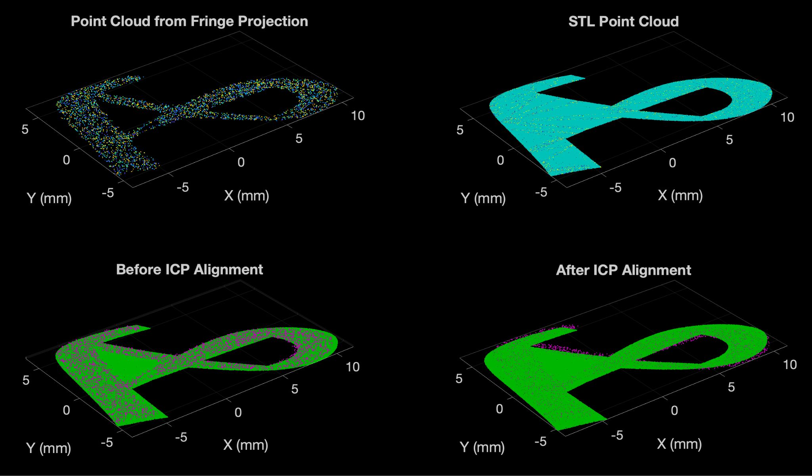
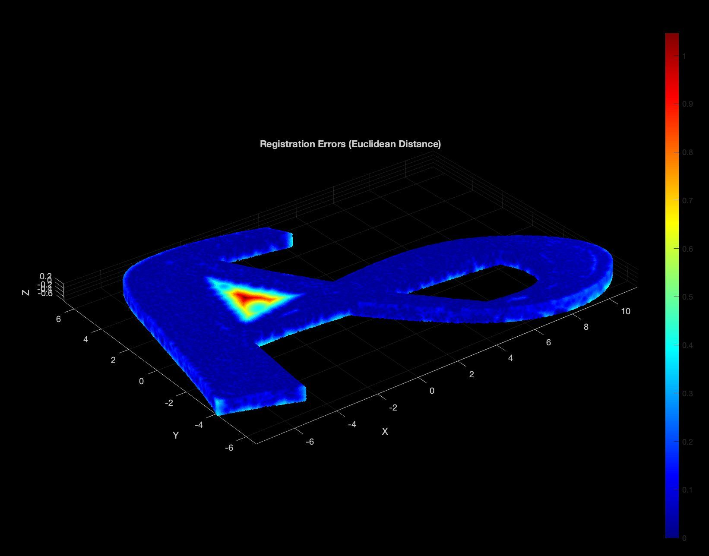
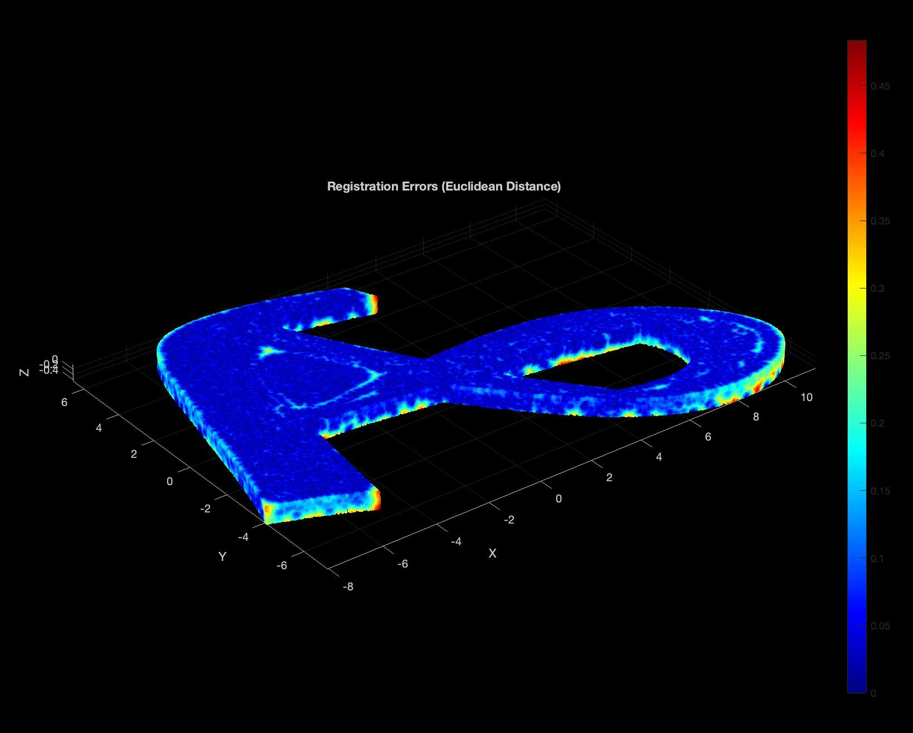

# Layerview

Fringe-projection inspection and repair of 3D-printed parts. Developed for ME 395, Industry 4.0, at Northwestern University, with a final demonstration presented on March 12, 2025.

**Carter Taylor developed the core MATLAB processing pipeline and ICP registration workflow.** The pipeline turns measured point clouds into aligned comparisons against CAD, with filtering, reference-surface sampling, PCA initialization, point-to-plane ICP, and geometric residual maps. The team connected the inspection workflow to missing-geometry reconstruction and repair printing on an Ender 3 Pro.



Figure from the original team presentation. The measured fringe-projection surface is compared with a sampled STL reference before and after registration.

## What is included

- A cleaned MATLAB pipeline with configurable inputs and a registration demo using a saved, processed project scan.
- The coin CAD models, checkerboard image, and an input-file checksum manifest.
- Source-only exports of the original course scripts, retained separately for provenance.
- The [final presentation](docs/layerview-final-presentation.pdf) and original result figures.

The original course folder contained about 6 GB of scans, duplicate datasets, unrelated homework, and generated files. This repository keeps a compact working example. Full-resolution XYZ scans remain outside Git; see [data notes](data/README.md).

## Run the registration demo

Use MATLAB R2024b or newer with Computer Vision Toolbox, Statistics and Machine Learning Toolbox, and Image Processing Toolbox. From the repository root:

```matlab
addpath('matlab');
result = run_layerview();
```

The demo uses the included processed PLY and reference STL. Generated point clouds, a JSON report, residual CSV files, and a figure are written under `outputs/processed_demo/`. The source inputs are not overwritten.

For a headless run:

```matlab
c = layerview.defaultConfig();
c.makePlots = false;
result = run_layerview(c);
```

To process your full-resolution, already calibrated XYZ files:

```matlab
c = layerview.defaultConfig();
c.inputMode = 'raw';
c.paths.rawReference = fullfile(pwd, 'data', 'raw', 'baseline.xyz');
c.paths.rawScan = fullfile(pwd, 'data', 'raw', 'part.xyz');
c.outputName = 'raw_scan';
result = run_layerview(c);
```

Inspect the parameters in [`defaultConfig.m`](matlab/+layerview/defaultConfig.m) before changing datasets. Baseline height filtering, coordinate reflections, sampling density, and repair thresholds are specific to the experimental geometry. The raw-input route starts from reconstructed XYZ coordinates; camera/projector acquisition and phase-to-height reconstruction are outside this repository.

## Validation

```matlab
addpath('matlab');
results = runtests('tests');
assertSuccess(results);
```

Tests cover sampling, rigid transformations, registration, directional residuals, homography, and repair-mesh geometry. [GitHub Actions](https://github.com/ctaylor6/layerview/actions/workflows/matlab.yml) runs the tests and the included processed-scan demo with MATLAB R2024b. Historical figures in this README come from the course presentation; newly generated demo metrics are written to `report.json`.

## Workflow

1. Calibrate scan coordinates and use a baseline scan to remove the height offset.
2. Filter outliers and isolate the printed feature from the base.
3. Sample the reference STL surface and initialize orientation with PCA.
4. Refine the rigid alignment using MATLAB's `pcregistericp` with a point-to-plane metric.
5. Compute nearest-neighbor residuals and inspect the spatial error map.
6. For the repair demonstration, extract missing geometry and form an extruded STL patch.

MATLAB supplies the ICP solver; the project contribution is the processing and registration pipeline around it. The repository does not include the fringe-pattern acquisition/phase-reconstruction software or a printer-control interface.

## Reported demonstration results

The March 2025 presentation reports control-case registration RMSE values of **0.082, 0.084, and 0.085 mm**. The illustrated repair comparison reports **0.15 mm before repair** and **0.10 mm after repair**. These results apply to the demonstrated coin-and-letter geometries. Registration residuals are not an independent calibration of absolute scanner accuracy.

| Defective part                                         | After repair                                           |
| ------------------------------------------------------ | ------------------------------------------------------ |
|  |  |
| Reported RMSE: 0.15 mm                                 | Reported RMSE: 0.10 mm                                 |

The two heatmaps use different color scales. Historical presentation results should not be treated as expected output from the cleaned demonstration, which uses a saved processed scan and revised initialization.

## Team and provenance

Natalie Gurganus, Zihan Chen, Lisa Kovacs, Jeremy Lu, and Carter Taylor.

The presentation documents the team project; Carter's portfolio identifies his contribution to the core processing and ICP workflow. See [source and cleanup notes](docs/source-map.md) for the relationship between the course scripts and the maintained code. No project-wide software license has been assigned; the original third-party helper files are not redistributed here.

## Links

- [Project portfolio](https://carter-taylor.com/projects/layerview/)
- [Final presentation](docs/layerview-final-presentation.pdf)
